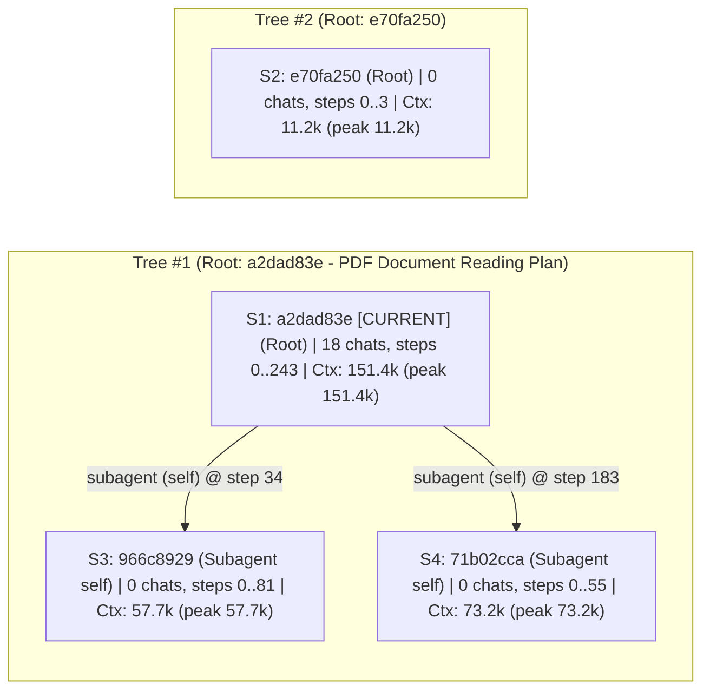

# ⚡ `pigdata` — Multi-Session & Fork Command Center

> [!TIP]
> **Zero-Context-Overhead Sync:** All 5 project guides and 4 session/fork logs are indexed in this session's native artifact hub (`a2dad83e-419e-4185-87cc-06f04d1d21a1`) by an external Python script (`0` LLM tokens used). Click any document below to open the original brain artifact in **Antigravity's native styled Artifact Viewer**.

---

## 1. Synced Project Knowledge Base (5 Native Artifacts)

| Category | Timestamp | Document (Click for Native View) | Summary & Purpose | Key Sections | Origin Session (Full ID) |
| :--- | :--- | :--- | :--- | :--- | :--- |
| **📘 Deep Dive** | `2026-10-30 07:38` | [**`demo_cheatsheet.md`**](file:///Users/iamqazolp/.gemini/antigravity/brain/a2dad83e-419e-4185-87cc-06f04d1d21a1/demo_cheatsheet.md) | Step-by-step live demo command cheatsheet for presenting Phases 0, 1, and 2 to GVHD Nguyễn Thị Trang, including both full Docker/Kafka command... | `Instant Live Demo` · `Unit Tests & Schema/Pattern Verification` · `Inspect Individual Fraud Injector Patterns` · `Full Docker + Kafka Stack Commands` | [`a2dad83e-419e-4185-87cc-06f04d1d21a1`](conversation://a2dad83e-419e-4185-87cc-06f04d1d21a1) (`78 lines`) |
| **📘 Deep Dive** | `2026-10-30 07:28` | [**`walkthrough.md`**](file:///Users/iamqazolp/.gemini/antigravity/brain/a2dad83e-419e-4185-87cc-06f04d1d21a1/walkthrough.md) | Walkthrough covering Phase 0, Phase 1, and Phase 2 (Fraud Injector + Partition Balance Fix), all 16 commits on origin/main, verification comma... | `What Was Built` · `Commits` · `Verification Receipts` | [`a2dad83e-419e-4185-87cc-06f04d1d21a1`](conversation://a2dad83e-419e-4185-87cc-06f04d1d21a1) (`47 lines`) |
| **📘 Deep Dive** | `2026-10-30 07:28` | [**`progress_report_gvhd.md`**](file:///Users/iamqazolp/.gemini/antigravity/brain/a2dad83e-419e-4185-87cc-06f04d1d21a1/progress_report_gvhd.md) | Updated progress report for GVHD Nguyễn Thị Trang covering completed Phase 0, Phase 1, and Phase 2 (Fraud Injector + Kafka Partition Balance F... | `Tổng quan kiến trúc và các thành phần đã hoàn thành` · `Chuẩn hóa dữ liệu đa nguồn & Bộ tiêm gian lận` · `Phân tích & Trực quan hóa dữ liệu thực nghiệm` · `Kế hoạch tiếp theo` | [`a2dad83e-419e-4185-87cc-06f04d1d21a1`](conversation://a2dad83e-419e-4185-87cc-06f04d1d21a1) (`129 lines` · `4 visuals`) |
| **📘 Deep Dive** | `2026-10-30 00:34` | [**`ingestion_visual_report.md`**](file:///Users/iamqazolp/.gemini/antigravity/brain/a2dad83e-419e-4185-87cc-06f04d1d21a1/ingestion_visual_report.md) | Visual analysis of a 25-second live stream capture across Binance (5,508 trades), Blockchain (184 outputs from 107 transactions), and PaySim (... | `Binance Market Stream` · `Blockchain UTXO Fan-Out & PaySim Fallback` · `Kafka Partition Skew & Phase 2 Fraud Mix` | [`a2dad83e-419e-4185-87cc-06f04d1d21a1`](conversation://a2dad83e-419e-4185-87cc-06f04d1d21a1) (`36 lines` · `3 visuals`) |
| **📐 Spec & Plan** | `2026-10-30 00:34` | [**`implementation_plan.md`**](file:///Users/iamqazolp/.gemini/antigravity/brain/a2dad83e-419e-4185-87cc-06f04d1d21a1/implementation_plan.md) | Implementation plan for Phase 2 (Fraud Injector) plus the Kafka partition key fix for Binance events. | `Goal` · `Architecture & Data Flow` · `Partition Key Fix in ingestion/producer.py` · `Fraud Injector Design` | [`a2dad83e-419e-4185-87cc-06f04d1d21a1`](conversation://a2dad83e-419e-4185-87cc-06f04d1d21a1) (`73 lines` · `1 visuals`) |

---

## 2. Session & Fork Telemetry (4 Sessions across 2 Root Trees)

| Tree & Fork Lineage | Full Session ID (Click to Open / Copy to Resume) | Context Usage (Active / Peak) | Chats & Steps | Started -> Last Active | Authored Docs |
| :--- | :--- | :--- | :--- | :--- | :--- |
| `Tree #1` · 🌱 **Root Session** (`step 0`) *(PDF Document Reading Plan)* **(CURRENT)** | [`a2dad83e-419e-4185-87cc-06f04d1d21a1`](conversation://a2dad83e-419e-4185-87cc-06f04d1d21a1) | **`151.4k`** active / `151.4k` peak · `83.6k` out | **`18 chats`** · `244 steps` (`#0..#243`) | `2026-10-22 17:35` -> `2026-10-30 07:44` | [`demo_cheatsheet.md`](file:///Users/iamqazolp/.gemini/antigravity/brain/a2dad83e-419e-4185-87cc-06f04d1d21a1/demo_cheatsheet.md) · [`implementation_plan.md`](file:///Users/iamqazolp/.gemini/antigravity/brain/a2dad83e-419e-4185-87cc-06f04d1d21a1/implementation_plan.md) · [`ingestion_visual_report.md`](file:///Users/iamqazolp/.gemini/antigravity/brain/a2dad83e-419e-4185-87cc-06f04d1d21a1/ingestion_visual_report.md) · [`progress_report_gvhd.md`](file:///Users/iamqazolp/.gemini/antigravity/brain/a2dad83e-419e-4185-87cc-06f04d1d21a1/progress_report_gvhd.md) · [`walkthrough.md`](file:///Users/iamqazolp/.gemini/antigravity/brain/a2dad83e-419e-4185-87cc-06f04d1d21a1/walkthrough.md) |
| `Tree #1` · 🤖 **Subagent (`self`, d=1)** of `a2dad83e` @ `step 183` | [`71b02cca-5384-49ac-8ad1-75c666cd71d8`](conversation://71b02cca-5384-49ac-8ad1-75c666cd71d8) | **`73.2k`** active / `73.2k` peak · `24.0k` out | **`0 chats`** · `56 steps` (`#0..#55`) | `2026-10-30 07:14` -> `2026-10-30 07:21` | — |
| `Tree #1` · 🤖 **Subagent (`self`, d=1)** of `a2dad83e` @ `step 34` | [`966c8929-edcc-4ad4-bbd5-00a22a4200a5`](conversation://966c8929-edcc-4ad4-bbd5-00a22a4200a5) | **`57.7k`** active / `57.7k` peak · `22.8k` out | **`0 chats`** · `82 steps` (`#0..#81`) | `2026-10-22 17:40` -> `2026-10-22 17:49` | — |
| `Tree #2` · 🌱 **Root Session** (`step 0`) | [`e70fa250-56c6-47da-8cdc-20e297f3e5c2`](conversation://e70fa250-56c6-47da-8cdc-20e297f3e5c2) | **`11.2k`** active / `11.2k` peak · `707` out | **`0 chats`** · `4 steps` (`#0..#3`) | `2026-10-22 17:40` -> `2026-10-22 17:40` | — |

### Multi-Root Session Fork Forest (`mermaid`)

---

## 3. Recent Prompts Per Session / Fork

### [`a2dad83e-419e-4185-87cc-06f04d1d21a1`](conversation://a2dad83e-419e-4185-87cc-06f04d1d21a1) *(Current Session)*
- **Lineage:** Root Session (`step 0`) · **Context:** `151.4k` active (`151.4k` peak) · **Chats:** `18` (`steps #0..#243`) · **Active:** `2026-10-22 17:35` -> `2026-10-30 07:44`
  - **`[2026-10-30 07:14 · step #179]`** do fraud injector and rewrite the report
  - **`[2026-10-30 07:37 · step #223]`** give me a list of codes/commands that will be helpful in demo
  - **`[2026-10-30 07:42 · step #234]`** make a new branch that includes the local notes
  - **`[2026-10-30 07:43 · step #238]`** nevermind
  - **`[2026-10-30 07:44 · step #240]`** commit?

### [`71b02cca-5384-49ac-8ad1-75c666cd71d8`](conversation://71b02cca-5384-49ac-8ad1-75c666cd71d8)
- **Lineage:** Subagent (`self`) of `a2dad83e-419e-4185-87cc-06f04d1d21a1` @ step `183` · **Context:** `73.2k` active (`73.2k` peak) · **Chats:** `0` (`steps #0..#55`) · **Active:** `2026-10-30 07:14` -> `2026-10-30 07:21`

### [`966c8929-edcc-4ad4-bbd5-00a22a4200a5`](conversation://966c8929-edcc-4ad4-bbd5-00a22a4200a5)
- **Lineage:** Subagent (`self`) of `a2dad83e-419e-4185-87cc-06f04d1d21a1` @ step `34` · **Context:** `57.7k` active (`57.7k` peak) · **Chats:** `0` (`steps #0..#81`) · **Active:** `2026-10-22 17:40` -> `2026-10-22 17:49`

### [`e70fa250-56c6-47da-8cdc-20e297f3e5c2`](conversation://e70fa250-56c6-47da-8cdc-20e297f3e5c2)
- **Lineage:** Root Session (`step 0`) · **Context:** `11.2k` active (`11.2k` peak) · **Chats:** `0` (`steps #0..#3`) · **Active:** `2026-10-22 17:40` -> `2026-10-22 17:40`

---

## 4. Git Branches & Tip Commits

| Branch | Tip Commit | Subject |
| :--- | :--- | :--- |
| `main` **(active)** | `535e809` | Add live demo inspection script across all sources and fraud patterns |

*Last synced by `local-recap` skill at `2026-10-30 07:44:53`.*
