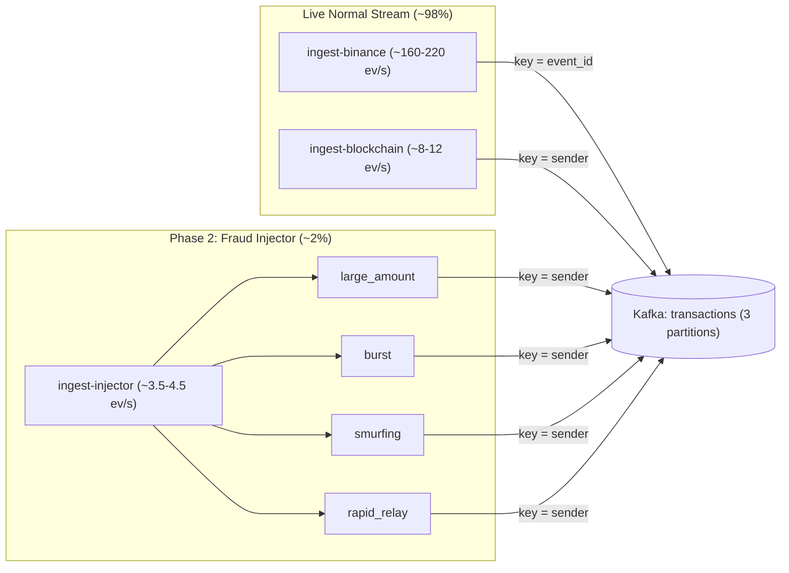

# Phase 2 Implementation Plan: Fraud Injector & Partition Key Fix

## Goal

Build the **Fraud Injector** (`PLAN.md` Phase 2) to emit ~2% labeled synthetic fraud (`source="injector"`, `is_injected=true`) into the `transactions` Kafka topic, and fix the Binance partition skew in [`EventProducer`](../ingestion/producer.py#L34-L54).

## Architecture & Data Flow

## 1. Partition Key Fix in `ingestion/producer.py`

In [`EventProducer.send`](../ingestion/producer.py#L48-L54), select the Kafka record key via a helper function `partition_key(event: Event) -> bytes`:
- If `event.source == "binance"`, return `event.event_id.encode()`. Binance trades have no wallet address, so spreading them across partitions removes the 85.2% Partition 2 hotspot without affecting per-wallet ordering.
- Otherwise (`blockchain`, `paysim`, `injector`), return `event.sender.encode()`. All events from a given wallet stay ordered on one partition for the 3–5 minute sliding window in Phase 4.

## 2. Fraud Injector Design (`ingestion/sources/injector.py`)

We organize the four fraud patterns from Slide 5 as a registry of pure generator functions `PatternFn = Callable[[ random.Random, int ], list[Event]]`, keeping pattern synthesis separate from the async rate scheduler.

| `fraud_pattern` | Share of Injected Events | Events per Incident | Shape & Ground-Truth Rule |
|---|---|---|---|
| `large_amount` | 25% | 1 event | Single transfer or trade with `amount` set to 10x–50x the p99 threshold (e.g., 25–150 BTC on-chain or $75k–$250k USDT trade). |
| `burst` | 35% | 15–25 events | Rapid fire of transfers from a single synthetic `sender` wallet (`bc1qfraudburst...`) to random receivers within 2–10 seconds, designed to trip the 3–5 minute frequency window. |
| `smurfing` | 25% | 8–12 events | A single `sender` wallet splits a large sum into 8–12 nearly identical sub-threshold outputs (`0.08–0.095 BTC` each) to distinct `receiver` addresses at the same timestamp. |
| `rapid_relay` | 15% | 4–6 events | Hop chain `A -> B -> C -> D -> E` within a few seconds where each hop forwards 98%–99.5% of the previous amount (peeling/relay chain). |

### Rate Control (2% Target Ratio)
- The live streams average ~170–230 events/s combined (`binance` + `blockchain`).
- At `--rate 4.0` events/s default (configurable via `--rate` and `--pattern-weights`), injected events represent ~1.8%–2.3% of total Kafka traffic.
- Because `burst`, `smurfing`, and `rapid_relay` emit multi-event incidents, the scheduler sleeps `len(events) / rate` seconds after each generated incident so the long-run event rate matches `--rate` regardless of incident size.

## 3. Files to Create or Modify

- [producer.py](../ingestion/producer.py). Add `partition_key(event)` and use it in `EventProducer.send`.
- `ingestion/sources/injector.py`. Pattern registry (`PATTERNS`), deterministic `generate_incident(pattern, rng, now_ms) -> list[Event]`, and async `stream(rate, seed) -> AsyncIterator[list[Event]]`.
- [__main__.py](../ingestion/__main__.py). Add `injector` to `--source` choices and wire `--rate` (default `4.0` for injector, `100.0` for paysim).
- [docker-compose.yml](../docker-compose.yml). Add `ingest-injector` service (`command: ["--source", "injector", "--rate", "4"]`).
- [verify_ingestion.py](../scripts/verify_ingestion.py). Validate `record.key == partition_key(event)` and report `is_injected` and `fraud_pattern` breakdowns.
- [test_parsers.py](../tests/test_parsers.py). Add tests for all 4 fraud patterns (verifying invariants: `is_injected=True`, amount ranges, sender fan-out for `smurfing`, hop chaining `events[i].receiver == events[i+1].sender` for `rapid_relay`, and rate sleep math).

## 4. Throughput Checkpoint

- **Blocking first steps.** Update `partition_key` in `ingestion/producer.py` first so `verify_ingestion.py` and tests agree on key invariants.
- **Independent workstreams.** `n/a: single-module addition (~150 lines across injector.py and tests)`.
- **Shared mutable state.** None. `ingest-injector` runs as an isolated container writing to the `transactions` topic.
- **Smallest safe decomposition.** One sequence of 2 verifiable commits: (1) partition key fix + fraud injector module & unit tests, (2) Docker Compose service + live Kafka verification.

## 5. Verification Plan

1. `uv run pytest -q` passes with unit tests covering all 4 fraud patterns and `partition_key`.
2. Bring up the stack (`docker compose up -d --build`) including `ingest-injector`.
3. Run `uv run scripts/verify_ingestion.py -n 3000 --require binance blockchain injector` and confirm:
   - All 4 `fraud_pattern` values (`large_amount`, `burst`, `smurfing`, `rapid_relay`) appear in Kafka with `is_injected=true`.
   - Injected share sits near ~2% of live traffic.
   - Kafka partition distribution across Partitions 0, 1, and 2 is balanced within 30%–37% per partition.
