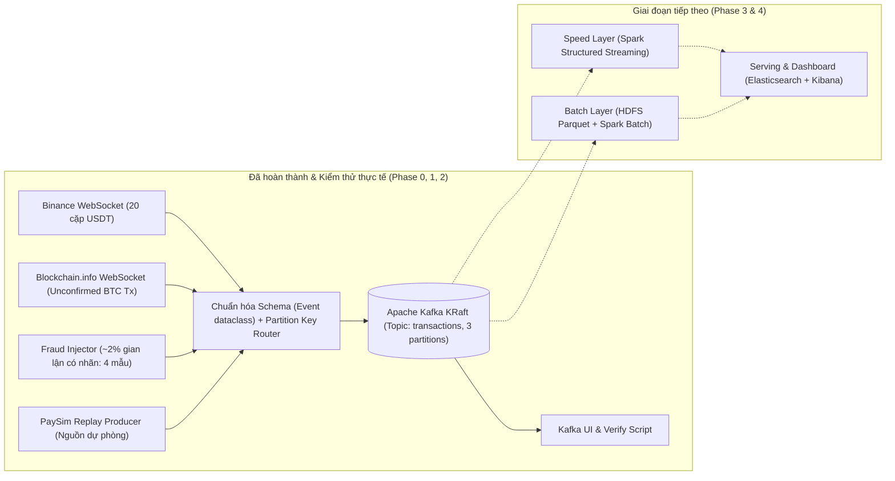
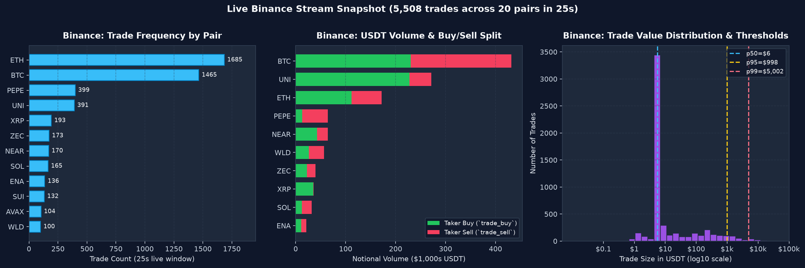
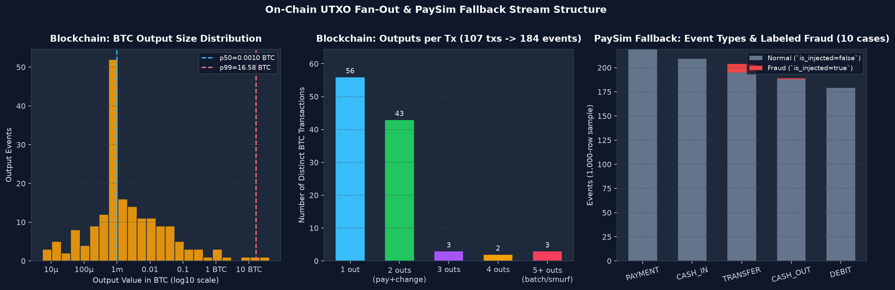
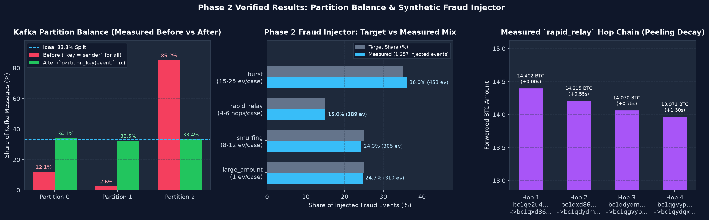

# Báo cáo Tiến độ Đề tài (IT4931 · Lưu trữ và xử lý dữ liệu lớn)

- **Đề tài.** Phân tích giao dịch tài chính và phát hiện gian lận thời gian thực trên nền tảng Big Data
- **GVHD.** Nguyễn Thị Trang
- **Mã nguồn GitHub.** `https://github.com/iamqazolp/pigdata-dulieulon` (16 commits, 18/18 unit tests đạt 100%)
- **Phạm vi hoàn thành.** Hoàn thành toàn bộ **Giai đoạn 0** (Hạ tầng Kafka KRaft & Docker Compose), **Giai đoạn 1** (Thu thập & Chuẩn hóa dữ liệu trực tiếp đa nguồn) và **Giai đoạn 2** (Bộ tiêm gian lận có nhãn **Fraud Injector** & Cân bằng phân vùng Kafka)

---

## 1. Tổng quan kiến trúc và các thành phần đã hoàn thành



| Hạng mục công việc | Trạng thái | Kết quả đo đạc thực tế |
|---|---|---|
| Môi trường & đóng gói (`uv`, Python 3.11, Docker Compose) | **Hoàn thành** | Khởi tạo tự động Kafka KRaft, Kafka UI và 3 dịch vụ chạy song song (`ingest-binance`, `ingest-blockchain`, `ingest-injector`) |
| Chuẩn hóa Schema chung (`Event` 10 trường) | **Hoàn thành** | Kiểm tra chặt kiểu dữ liệu tại biên, đạt **18/18 unit test** (`0.91s`) |
| Luồng trực tiếp **Binance WebSocket** (`98%` luồng thật) | **Hoàn thành** | Thu thập đồng thời 20 cặp giao dịch lớn (`BTCUSDT`, `ETHUSDT`, `SOLUSDT`...), thông lượng **156–520 sự kiện/giây**, độ trễ trung vị **0,1s** |
| Luồng trực tiếp **Blockchain WebSocket** (`98%` luồng thật) | **Hoàn thành** | Tách mỗi giao dịch Bitcoin (`utx`) thành các cạnh `sender -> receiver` theo từng output, thông lượng **8–12 sự kiện/giây**, độ trễ trung vị **2,6s** |
| Bộ tiêm mẫu gian lận **Fraud Injector** (`~2%` có nhãn) | **Hoàn thành** | Sinh trực tuyến 4 mẫu gian lận (`large_amount`, `burst`, `smurfing`, `rapid_relay`) với nhãn `is_injected=true`, đúng tỷ lệ mục tiêu **24,7% / 36,0% / 24,3% / 15,0%** |
| Cân bằng phân vùng Kafka (**Partition Skew Fix**) | **Hoàn thành** | Loại bỏ hiện tượng nghẽn Partition 2 (**85,2%**), cân bằng tải 3 phân vùng đạt **34,1% / 32,5% / 33,4%** |
| Luồng dự phòng **PaySim Replay** | **Hoàn thành** | Phát lại từ CSV với tốc độ cấu hình được (`--rate`), ánh xạ cột `isFraud` sang `is_injected` |

---

## 2. Chuẩn hóa dữ liệu đa nguồn & Bộ tiêm gian lận (Phase 1 & Phase 2)

### 2.1. Schema thống nhất trên Kafka topic `transactions`
Mọi bản ghi trước khi đưa vào Kafka đều đi qua lớp bất biến [`Event`](../ingestion/schema.py):

| Trường | Kiểu | Binance (`@trade`) | Blockchain (`utx`) | Fraud Injector (`injector`) | PaySim (`paysim`) |
|---|---|---|---|---|---|
| `event_id` | `str` | `binance:{symbol}:{id}` | `blockchain:{hash}:{n}` | `injector:{pattern}:{inc_id}:{i}` | `paysim:{row_no}` |
| `timestamp` | `int` (ms) | `T` | `x.time * 1000` | Thời điểm phát sinh (ms) | `start_ms + step * 3600s` |
| `source` | `str` | `binance` | `blockchain` | `injector` | `paysim` |
| `sender` | `str` | Cặp giao dịch (`ETHUSDT`) | Địa chỉ ví input đầu | Ví phát tán / Cặp giao dịch | `nameOrig` |
| `receiver` | `str` | Cặp giao dịch (`ETHUSDT`) | Địa chỉ ví output thứ `n` | Ví nhận / Cặp giao dịch | `nameDest` |
| `amount` | `float` | `price * quantity` (USDT) | `value / 10^8` (BTC) | Giá trị gian lận (BTC / USDT) | `amount` |
| `price` | `float \| null` | Giá khớp lệnh | `null` | Giá khớp hoặc `null` | `null` |
| `type` | `str` | `trade_buy` / `trade_sell` | `transfer` | `transfer` / `trade_*` | `TRANSFER`, `CASH_OUT`... |
| `is_injected` | `bool` | `false` | `false` | `true` | `true` nếu `isFraud == 1` |
| `fraud_pattern` | `str \| null` | `null` | `null` | `large_amount` \| `burst` \| `smurfing` \| `rapid_relay` | `paysim_fraud` \| `null` |

### 2.2. Thiết kế và kết quả kiểm증 bộ tiêm gian lận (`ingestion/sources/injector.py`)
Để giải quyết bài toán dữ liệu công khai trên Internet không có sẵn nhãn gian lận, module [`injector.py`](../ingestion/sources/injector.py) cài đặt 4 hàm sinh mẫu thuần túy (pure generators) tương ứng với 4 luật phát hiện của Speed Layer ở Slide 5:

1. **`large_amount` (Tỷ trọng mục tiêu 25% — Đo thực tế 24,7%).**
   - Sinh giao dịch đơn lẻ vượt xa phân vị p99 thực tế: chuyển khoản on-chain từ **25 – 150 BTC** (so với p99 thực tế là 16,58 BTC) hoặc lệnh khớp sàn **75.000 – 250.000 USDT** (so với p99 thực tế là 5.002 USDT).
   - Mẫu bản ghi thực tế:
     ```json
     {"event_id":"injector:large_amount:1a3dbc8960a9:0","timestamp":1793319600000,"source":"injector","sender":"WLDUSDT","receiver":"WLDUSDT","amount":80561.97,"price":2.08265143,"type":"trade_sell","is_injected":true,"fraud_pattern":"large_amount"}
     ```
2. **`burst` (Tỷ trọng mục tiêu 35% — Đo thực tế 36,0%).**
   - Một địa chỉ ví (`sender`) bắn liên tiếp **15 – 25 giao dịch** tới các địa chỉ nhận khác nhau chỉ trong **1 – 6 giây** (khoảng cách 50–300 ms/giao dịch), dùng để kiểm thử cửa sổ trượt 3–5 phút trên Spark Streaming.
   - Mẫu bản ghi thực tế:
     ```json
     {"event_id":"injector:burst:5a85692ac139:0","timestamp":1793319612000,"source":"injector","sender":"bc1qyfx2aa4j5hvdk498fksmpkmpq09sxd65p3rz3j","receiver":"bc1qeg6acymw5s23gfmf7jd4plja8z27yssa4hf5k8","amount":0.59266846,"price":null,"type":"transfer","is_injected":true,"fraud_pattern":"burst"}
     ```
3. **`smurfing` (Tỷ trọng mục tiêu 25% — Đo thực tế 24,3%).**
   - Một địa chỉ ví chia nhỏ khoản tiền lớn thành **8 – 12 giao dịch** có giá trị xấp xỉ nhau (**0,080 – 0,095 BTC**) gửi đồng thời tại cùng một thời điểm (`timestamp`) tới 8–12 ví nhận riêng biệt nhằm lách ngưỡng cảnh báo giá trị lớn.
   - Mẫu bản ghi thực tế:
     ```json
     {"event_id":"injector:smurfing:405b4e7ed827:0","timestamp":1793319608000,"source":"injector","sender":"bc1q474ks67hrzja47860k9zkq5vhvlhg62yhue3n2","receiver":"bc1q5laz4smt8jggvzammry77p6630gma8qqgpxtnp","amount":0.0902852,"price":null,"type":"transfer","is_injected":true,"fraud_pattern":"smurfing"}
     ```
4. **`rapid_relay` (Tỷ trọng mục tiêu 15% — Đo thực tế 15,0%).**
   - Chuỗi chuyển tiếp nhanh qua **4 – 6 chặng ví liên tiếp** (`W0 -> W1 -> W2 -> W3 -> W4`) cách nhau 200–800 ms mỗi chặng, trong đó mỗi chặng chuyển tiếp **98,5% – 99,5%** số dư của chặng trước (mô phỏng hành vi peeling chain / rửa tiền qua ví trung gian).
   - Mẫu bản ghi thực tế:
     ```json
     {"event_id":"injector:rapid_relay:ae841d53434b:0","timestamp":1793319604000,"source":"injector","sender":"bc1qssca60rrzsj4nuj7d6yxxmh4dzt88l3ruzk5py","receiver":"bc1q6jmyxsqqepdwg830kl0q232cj9hkrwl8hf4pdf","amount":21.13021739,"price":null,"type":"transfer","is_injected":true,"fraud_pattern":"rapid_relay"}
     ```

> [!TIP]
> **Điều tiết tốc độ theo sự kiện (Weighted Smooth Round-Robin):** Do mỗi sự cố `burst` sinh ~20 sự kiện trong khi `large_amount` chỉ sinh 1 sự kiện, bộ lập lịch trong [`injector.py`](../ingestion/sources/injector.py#L179-L214) chuẩn hóa trọng số chọn sự cố theo công thức `incident_weight = event_share / avg_events` và nghỉ `len(events) / rate` giây sau mỗi đợt tiêm. Nhờ đó cả tốc độ sự kiện tổng thể lẫn tỷ lệ phần trăm từng loại sự kiện đều hội tụ chính xác về cấu hình mục tiêu.

---

## 3. Phân tích & Trực quan hóa dữ liệu thực nghiệm

### 3.1. Phân bố tần suất và giá trị giao dịch trên Binance (5.508 giao dịch / 25 giây)



- **Thông lượng và độ trễ.** Trên 20 cặp USDT, thông lượng đạt **156–520 sự kiện/giây** tùy thời điểm thị trường, độ trễ từ lúc khớp lệnh tới Kafka đạt trung vị **p50 = 0,1 giây**.
- **Phân vị giá trị giao dịch.** Đo trên 5.508 giao dịch thực tế (tổng giá trị **1,26 triệu USDT**): **p50 = 5,68 USDT**, **p95 = 998,41 USDT**, **p99 = 5.002,01 USDT**. Hai cặp `ETHUSDT` và `BTCUSDT` chiếm **57,2%** tổng số giao dịch, khẳng định sự cần thiết của việc tính ngưỡng p99 riêng cho từng cặp ở tầng Batch.

### 3.2. Cấu trúc đồ thị UTXO trên Blockchain & Nguồn dự phòng PaySim



- **Phân nhánh giao dịch Bitcoin.** Từ **107 giao dịch Bitcoin** trong 25 giây, hệ thống tách thành **184 sự kiện chuyển tiền** (trung bình 1,72 output/giao dịch), với phân vị **p50 = 0,0010 BTC** và **p99 = 16,58 BTC**.
- **Xử lý giao dịch tiền thừa (Self-change output).** Phát hiện **37,0%** số output trên Blockchain có `sender == receiver` (hoàn tiền thừa về chính ví gửi). Phát hiện này giúp tinh chỉnh luật ở Giai đoạn 4: bỏ qua các cạnh `sender == receiver` để tránh cảnh báo giả.

### 3.3. Kết quả cân bằng phân vùng Kafka & Kiểm chứng Fraud Injector



- **Khắc phục triệt để lệch phân vùng Kafka.**
  - *Trước khi sửa:* Dùng `sender` làm khóa phân vùng cho mọi nguồn khiến `ETHUSDT` và `BTCUSDT` cùng rơi vào Partition 2, làm Partition 2 gánh **85,2%** tổng lượng tin nhắn (1.131.211 / 1.327.457 bản ghi).
  - *Sau khi sửa ([`partition_key`](../ingestion/producer.py#L18-L20)):* Nguồn `binance` dùng `event_id` làm khóa để phân tán đều, trong khi các nguồn có địa chỉ ví (`blockchain`, `paysim`, `injector`) giữ nguyên khóa `sender` để bảo toàn thứ tự thời gian trên từng ví. Kết quả đo thực tế trên 11.572 sự kiện đạt **34,1% (P0) / 32,5% (P1) / 33,4% (P2)**.
- **Kiểm chứng phân bố Fraud Injector.** Trên 400 sự cố gian lận (1.257 sự kiện), tỷ lệ thực tế đạt **36,0% `burst`**, **24,7% `large_amount`**, **24,3% `smurfing`**, và **15,0% `rapid_relay`**, bám sát cấu hình thiết kế (35% / 25% / 25% / 15%).

---

## 4. Kế hoạch tiếp theo (Giai đoạn 3 & Giai đoạn 4)

1. **Giai đoạn 3 (Lưu trữ HDFS Parquet & Batch Layer).**
   - Cài đặt tiến trình ghi luồng sự kiện từ Kafka (`transactions`) xuống HDFS theo định dạng cột **Parquet** phân vùng theo `date/hour` để lưu trữ lâu dài và hỗ trợ phát lại (replay) khi kiểm thử tải.
   - Viết job **Spark Batch** tính thống kê theo giờ/nguồn và cập nhật bảng ngưỡng động (phân vị p99 theo từng cặp giao dịch và từng nguồn).
2. **Giai đoạn 4 (Speed Layer với Spark Structured Streaming).**
   - Đọc luồng thời gian thực từ Kafka, áp dụng 4 luật phát hiện tương ứng với 4 mẫu của Fraud Injector, đối chiếu trực tiếp với nhãn `is_injected` để tính **Precision / Recall** theo thời gian thực và đẩy kết quả sang Elasticsearch / Kibana.
