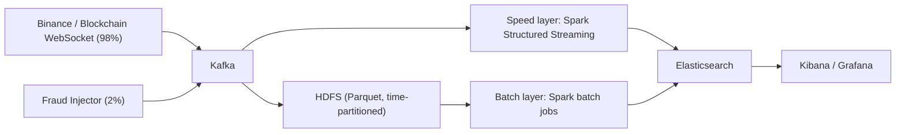

# Plan: Real-time Financial Transaction Analysis & Fraud Detection on Big Data

IT4931 · Lưu trữ và xử lý dữ liệu lớn · GVHD: Nguyễn Thị Trang

## 1. Goal

Build a Lambda-architecture system that ingests a live public transaction stream (Binance / Blockchain WebSocket), mixes in ~2% labeled synthetic fraud, detects fraud in real time, runs periodic batch analysis, and shows results on a dashboard. Deploy on Kubernetes and demonstrate scalability and fault tolerance.

## 2. Architecture

| Component | Technology | Role |
|---|---|---|
| Sources | Binance / Blockchain WebSocket | Real events (98%) |
| Fraud Injector | Python producer | Labeled fraud samples (2%) |
| Message queue | Kafka | Decouple producers from analytics |
| Speed layer | Spark Structured Streaming | Real-time rule detection |
| Batch layer | Spark on HDFS Parquet | Periodic stats, threshold tuning |
| Serving | Elasticsearch | Real-time view + batch view |
| Dashboard | Kibana / Grafana | Monitoring and alerts |
| Platform | K3s / Minikube | Multi-node deployment |
| Fallback data | PaySim (Kaggle, 6.5M rows, 0.13% fraud) | Replayed as a simulated stream |

## 3. Unified event schema (Kafka topic `transactions`)

| Field | Type | Description |
|---|---|---|
| `event_id` | string | Unique event ID |
| `timestamp` | timestamp (ms) | Event time |
| `source` | enum | `binance` \| `blockchain` \| `injector` |
| `sender` | string | Wallet address or trading pair |
| `receiver` | string | Wallet address or trading pair |
| `amount` | double | Volume / value |
| `price` | double | Price (if applicable) |
| `type` | string | Event type (trade, transfer, ...) |
| `is_injected` | bool | Ground-truth label |
| `fraud_pattern` | string \| null | `large_amount`, `burst`, `smurfing`, `rapid_relay`, ... |

## 4. Phases

### Phase 0: Setup (week 1)
- [ ] Repo layout: `ingestion/`, `injector/`, `streaming/`, `batch/`, `serving/`, `deploy/`, `docs/`
- [ ] Docker Compose dev stack: Kafka, HDFS (namenode + datanode), Spark, Elasticsearch, Kibana
- [ ] Choose language (recommended: PySpark) and pin versions

### Phase 1: Ingestion (week 2)
- [ ] Binance WebSocket connector (e.g. `@trade` streams for several symbols)
- [ ] Blockchain WebSocket connector (unconfirmed transactions)
- [ ] Normalizer to the unified schema, then publish to Kafka
- [ ] Reconnect / backoff handling for connection limits
- [ ] PaySim replay producer (fallback source, configurable rate)

### Phase 2: Fraud Injector (week 2)
- [ ] Inject ~2% of total traffic with `is_injected=true` and a `fraud_pattern`
- [ ] Patterns:
  - `large_amount`: amount far above normal distribution
  - `burst`: many events from one address within 3–5 minutes
  - `smurfing`: one large amount split into many small transfers
  - `rapid_relay`: funds chained quickly across several addresses
- [ ] Configurable injection ratio and pattern mix

### Phase 3: Storage + Batch layer (week 3)
- [ ] Kafka → HDFS sink: Parquet, partitioned by `date/hour`, replayable
- [ ] Spark batch jobs (scheduled, e.g. hourly):
  - Volume / count per hour and per source
  - Alert rate per fraud pattern
  - Precision / recall of rules on historical data
  - Recompute thresholds (e.g. 99th percentile of amount per symbol)
- [ ] Write batch view to Elasticsearch; publish thresholds for the speed layer

### Phase 4: Speed layer (weeks 3–4)
- [ ] Spark Structured Streaming consumer from Kafka with checkpointing
- [ ] Rules:
  - Amount / volume above threshold
  - Per-address frequency burst in a 3–5 min sliding window (with watermark)
  - Split / rapid relay detection across addresses
- [ ] Emit alerts to Elasticsearch (`alerts` index)
- [ ] Compute live TP/FP/FN against `is_injected` → precision / recall
- [ ] No balance-based rules (live sources have no account balance)

### Phase 5: Serving + Dashboard (week 5)
- [ ] Elasticsearch indices: `realtime_view`, `batch_view`, `alerts`, `metrics`
- [ ] Dashboard panels:
  - Throughput (TPS) over time
  - Latest alerts (count + list)
  - Live precision / recall
  - Top suspicious addresses

### Phase 6: Kubernetes deployment (week 6)
- [ ] Multi-node K3s (or Minikube) cluster
- [ ] Deploy Kafka (Strimzi), Spark (spark-operator), HDFS, Elasticsearch/Kibana (ECK) via Helm/manifests
- [ ] Producers and jobs as Deployments / CronJobs

### Phase 7: Scalability & fault-tolerance tests (week 7)
- [ ] Scalability:
  - Raise load with more symbols + HDFS replay at higher rates
  - Measure throughput and end-to-end latency
  - Scale out Spark workers and Kafka partitions/consumers; compare results
- [ ] Fault tolerance:
  - Kill a Spark worker node mid-stream
  - Kill a Kafka broker mid-stream (replication factor ≥ 2)
  - Verify continuous operation and no data loss (event counts in vs. out)

### Phase 8: Report & demo (week 8)
- [ ] Architecture, design decisions, and test results with charts
- [ ] Live demo script
- [ ] State limitations clearly (see §6)

## 5. Evaluation metrics

| Metric | How |
|---|---|
| Precision / Recall / F1 | Alerts vs. `is_injected` labels, live and per batch |
| Throughput (TPS) | Events/sec through Kafka and Spark |
| End-to-end latency | `alert_time - event timestamp` |
| Recovery | Time to recover + lost-event count after node/broker failure |

## 6. Risks & caveats

| Risk | Mitigation |
|---|---|
| No account balance in live data | Drop PaySim-style balance rules |
| Internet dependency / rate limits | Record stream to HDFS, replay for tests; PaySim fallback |
| 2% fraud is unrealistically high | State clearly it is synthetic, for evaluation only |
| Two sources with different formats | Normalize to one schema before Kafka |
| Scope | Public on-chain/exchange events, not bank transactions |

## 7. Open decisions
- PySpark vs. Scala
- Kibana vs. Grafana
- Primary source: Binance or Blockchain
- Team size and task split
