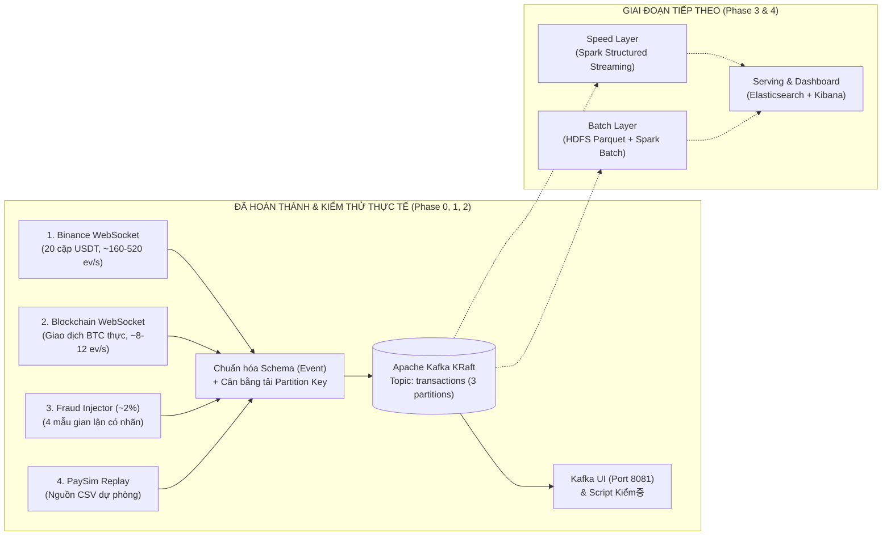

# Hướng dẫn Thuyết trình & Demo Đồ án Big Data (IT4931)

- **Đề tài.** Phân tích giao dịch tài chính và phát hiện gian lận thời gian thực trên nền tảng Big Data
- **GVHD.** Nguyễn Thị Trang
- **Nhánh tài liệu thuyết trình.** `notes` (Nhánh này bao gồm toàn bộ mã nguồn + báo cáo tiến độ + biểu đồ trực quan + kịch bản demo cho thành viên nhóm thuyết trình)
- **Tài liệu liên quan trong `.local-notes/`.**
  - [Báo cáo tiến độ chi tiết gửi GVHD](./.local-notes/progress_report_gvhd.md)
  - [Báo cáo phân tích & trực quan hóa dữ liệu](./.local-notes/ingestion_visual_report.md)
  - [Bảng tóm tắt lệnh Demo nhanh](./.local-notes/demo_cheatsheet.md)
  - [Walkthrough kỹ thuật & danh sách Commit](./.local-notes/walkthrough.md)

---

## 1. Tóm tắt 30 giây cho người thuyết trình (Nắm cốt lõi trước khi lên bảng)

### Bài toán nhóm giải quyết là gì?
Các đồ án phát hiện gian lận truyền thống thường chỉ đọc một file CSV tĩnh (như PaySim trên Kaggle) rồi giả lập gửi từng dòng. Cách đó không phản ánh đúng bản chất dữ liệu lớn thời gian thực. Ngược lại, nếu lấy luồng giao dịch thật từ Internet (Binance, Blockchain) thì lại **không có nhãn gian lận (`ground-truth`)** để đo độ chính xác (Precision / Recall).

**Giải pháp của nhóm:** Kết hợp **98% luồng giao dịch thật trực tiếp từ Internet** (Binance WebSocket + Blockchain Bitcoin WebSocket) trộn với **~2% giao dịch gian lận tổng hợp có gắn nhãn (`is_injected=true`)** do module **Fraud Injector** của nhóm tự sinh theo đúng 4 kịch bản gian lận thực tế, đồng thời vẫn giữ bộ phát lại **PaySim** làm nguồn dự phòng.

### Hiện tại nhóm đã làm xong tới đâu?


- **Đã hoàn thành 100% Giai đoạn 0, 1 và 2:**
  1. Hạ tầng **Apache Kafka (chế độ KRaft mới nhất, không cần ZooKeeper)** + **Kafka UI** trên Docker Compose.
  2. Bộ thu thập & chuẩn hóa 4 nguồn dữ liệu (`binance`, `blockchain`, `injector`, `paysim`) về một **Schema thống nhất gồm 10 trường**.
  3. Bộ tiêm mẫu gian lận **Fraud Injector** sinh trực tuyến 4 hành vi gian lận: giao dịch giá trị khổng lồ (`large_amount`), bắn giao dịch dồn dập (`burst`), chia nhỏ khoản tiền để lách ngưỡng (`smurfing`), và chuyển tiếp nhanh qua chuỗi ví trung gian (`rapid_relay`).
  4. Chạy bền thực tế **hơn 13 giờ liên tục**, thu thập **1.327.457 bản ghi hợp lệ (0 lỗi)**, phát hiện và **xử lý triệt để bài toán lệch phân vùng Kafka (Partition Skew từ 85,2% về 34,1% / 32,5% / 33,4%)**.

---

## 2. Kịch bản Demo Trực tiếp trên Lớp (Từ Nhanh nhất đến Đầy đủ nhất)

> [!TIP]
> **Mẹo an toàn khi thuyết trình:** Nhóm đã thiết kế sẵn công cụ `scripts/demo_inspect.py` chạy trực tiếp từ luồng Internet + Fraud Injector mà **không cần bật Docker**. Nếu máy tính trên bục giảng chưa bật Docker hoặc RAM yếu, bạn chỉ cần chạy **Bước 2.1** và **Bước 2.2** là đã trình diễn được toàn bộ dữ liệu thời gian thực chỉ trong 6 giây!

### Bước 2.0. Chuẩn bị trước giờ lên lớp (chỉ làm 1 lần, mất 15 giây)
Mở Terminal tại thư mục dự án:
```bash
git clone -b notes https://github.com/iamqazolp/pigdata-dulieulon.git
cd pigdata-dulieulon
uv sync
```
*(Nếu máy chưa cài `uv`, cài trong 5 giây bằng `curl -LsSf https://astral.sh/uv/install.sh | sh` hoặc `brew install uv`).*

---

### Bước 2.1. Demo 1 — Thu thập trực tiếp Đa nguồn + Bơm Gian lận + Cân bằng Phân vùng (Chạy trong 6 giây)

**Lệnh gõ trên Terminal:**
```bash
uv run scripts/demo_inspect.py --seconds 6
```

**Kết quả hiển thị trên màn hình (ví dụ thực tế):**
```text
=== Live Stream Window (6s) | Total: 4203 events (700.5 ev/s) ===
By source:        {'injector': 48, 'binance': 4129, 'blockchain': 26}
Fraud patterns:   {'large_amount': 9, 'rapid_relay': 4, 'smurfing': 10, 'burst': 25}
Partition split:  {'P0': '33.0%', 'P1': '34.4%', 'P2': '32.6%'}

[binance]
{"event_id":"binance:UNIUSDT:303040189","timestamp":1793320700424,"source":"binance","sender":"UNIUSDT","receiver":"UNIUSDT","amount":83.16604,"price":6.437,"type":"trade_sell","is_injected":false,"fraud_pattern":null}

[blockchain]
{"event_id":"blockchain:3acd01a5...e3d8:0","timestamp":1793320700000,"source":"blockchain","sender":"bc1qyf04uj3hv7ne79acqvws78t8e8g8uxhmgx94w4","receiver":"1Nt15emm8qpSyRYKZRayZHygvShgg7huQF","amount":0.09998537,"price":null,"type":"transfer","is_injected":false,"fraud_pattern":null}

[injector:burst]
{"event_id":"injector:burst:4cde10530be2:0","timestamp":1793320703900,"source":"injector","sender":"bc1q2wtq0vrgrg8482crqvq9kftj9ny7w098ryrcwc","receiver":"bc1q8xnqpzhuqvfrla7m3x504xd502qnqr3lduuw3v","amount":0.48618679,"price":null,"type":"transfer","is_injected":true,"fraud_pattern":"burst"}
...
```

**Lời thuyết minh khi chỉ vào màn hình:**
1. *"Thưa cô, chỉ trong 6 giây kết nối trực tiếp Internet, hệ thống đã thu thập hơn **4.200 sự kiện** (tốc độ ~700 sự kiện/giây)."*
2. *"Dòng `By source` cho thấy cả 3 luồng đang chảy song song: giao dịch khớp lệnh thật từ sàn **Binance**, giao dịch chuyển Bitcoin chưa xác nhận thật từ **Blockchain.info**, và các giao dịch gian lận có nhãn từ **Fraud Injector**."*
3. *"Dòng `Fraud patterns` cho thấy đủ 4 mẫu gian lận (`large_amount`, `burst`, `smurfing`, `rapid_relay`) đã được tiêm vào luồng với cờ `is_injected: true`."*
4. *"Dòng `Partition split` chứng minh bộ định tuyến khóa phân vùng của nhóm chia tải cực kỳ đều vào 3 partition của Kafka: **33,0% / 34,4% / 32,6%**."*

---

### Bước 2.2. Demo 2 — Chạy 18 Kiểm thử Tự động (Unit Tests) trong 1 giây

**Lệnh gõ trên Terminal:**
```bash
uv run pytest -v
```

**Lời thuyết minh:**
- *"Nhóm đã viết 18 bài kiểm thử tự động trong `tests/test_parsers.py` sử dụng dữ liệu thô thu thật từ WebSocket và kiểm tra toàn bộ các ràng buộc: kiểm tra kiểu dữ liệu Schema, kiểm tra tách nhiều output của giao dịch Bitcoin, kiểm tra định tuyến khóa Kafka, và kiểm tra tính chất toán học của cả 4 mẫu gian lận."*

---

### Bước 2.3. Demo 3 — Minh họa sâu từng hành vi Gian lận (Dùng khi cô hỏi chi tiết về Fraud Injector)

**1) Trình diễn mẫu `rapid_relay` (Chuỗi chuyển tiếp rửa tiền qua nhiều ví `W0 -> W1 -> W2 -> W3 -> W4`):**
```bash
uv run python -c "
import random
from ingestion.sources.injector import generate_incident
for i, e in enumerate(generate_incident('rapid_relay', random.Random(7), 1793319600000)):
    print(f'Chặng {i+1}: {e.sender[:14]}... -> {e.receiver[:14]}... | {e.amount:.4f} BTC | +{(e.timestamp-1793319600000)}ms')
"
```
*Giải thích:* Chỉ cho cô thấy **ví nhận (`receiver`) của chặng 1 chính là ví gửi (`sender`) của chặng 2**, thời gian chỉ cách nhau vài trăm mili-giây và số lượng BTC giảm nhẹ 0,5%–1,5% qua mỗi chặng (mô phỏng phí giao dịch / peeling chain khi tẩu tán tài sản).

**2) Trình diễn mẫu `smurfing` (Chia nhỏ khoản tiền lớn thành nhiều khoản nhỏ dưới ngưỡng cảnh báo):**
```bash
uv run python -c "
import random
from ingestion.sources.injector import generate_incident
for i, e in enumerate(generate_incident('smurfing', random.Random(7), 1793319600000)):
    print(f'Output {i+1:02d}: {e.sender[:14]}... -> {e.receiver[:14]}... | {e.amount:.5f} BTC | t={e.timestamp}')
"
```
*Giải thích:* Chỉ cho cô thấy **cùng một ví gửi (`sender`)** tại **cùng một mili-giây (`timestamp`)** chia nhỏ tiền cho 10 ví nhận khác nhau, mỗi khoản đều xấp xỉ `0.08–0.095 BTC` để né ngưỡng cảnh báo giao dịch lớn.

---

### Bước 2.4. Demo 4 — Chạy toàn bộ Cụm Docker Compose + Kafka KRaft + Giao diện Web Kafka UI

*(Chỉ chạy bước này khi máy đang bật sẵn Docker Desktop hoặc Colima).*

**1) Khởi động cụm Kafka, Kafka UI và 3 container thu thập dữ liệu:**
```bash
docker compose up -d --build
docker compose ps
```
- Mở trình duyệt vào **`http://localhost:8081`** (Kafka UI) -> bấm vào **Topics** -> **`transactions`** để cô xem trực tiếp 3 Partitions và các bản ghi đang đổ vào liên tục.

**2) Đọc 2.000 bản ghi trực tiếp từ Kafka và kiểm chứng tự động:**
```bash
uv run scripts/verify_ingestion.py -n 2000 --require binance blockchain injector
```
*Giải thích:* Script này đóng vai trò một Kafka Consumer độc lập, đọc 2.000 tin nhắn từ Kafka, kiểm tra 100% tin nhắn có đúng Schema `Event` và đúng khóa phân vùng hay không, đồng thời thống kê số lượng từng nguồn và từng mẫu gian lận.

**3) Demo nguồn dữ liệu dự phòng PaySim (Phát lại CSV vào Kafka với tốc độ 500 sự kiện/giây):**
```bash
uv run scripts/make_paysim_sample.py data/paysim_sample.csv 1000
uv run python -m ingestion --source paysim --csv data/paysim_sample.csv --rate 500
```

**4) Demo khả năng chịu lỗi (Fault Tolerance) — Khởi động lại Kafka khi đang chạy stream:**
```bash
docker compose restart kafka
sleep 20
docker compose ps
uv run scripts/verify_ingestion.py -n 500 --require binance blockchain injector
```
*Giải thích:* Dù Kafka Broker bị khởi động lại đột ngột, các container `ingest-binance`, `ingest-blockchain` và `ingest-injector` không hề bị sập (`Up`), tự động kết nối lại và gửi tiếp dữ liệu ngay khi Kafka sống lại.

---

## 3. Giải thích Cấu trúc Mã nguồn (Walkthrough từng File)

Nếu GVHD yêu cầu mở code giải thích, bạn mở theo đúng thứ tự luồng dữ liệu dưới đây:

```text
pigdata-dulieulon/
├── PLAN.md                         # Kế hoạch tổng thể 8 giai đoạn của đồ án
├── docker-compose.yml              # Định nghĩa cụm Kafka KRaft, Kafka UI và 3 container thu thập
├── pyproject.toml & uv.lock        # Quản lý thư viện Python 3.11 bằng uv (aiokafka, websockets, pytest)
├── ingestion/
│   ├── schema.py                   # [1] Định nghĩa dataclass Event (10 trường) + kiểm tra hợp lệ JSON
│   ├── producer.py                 # [2] Khởi tạo topic Kafka (3 partitions) + hàm partition_key + EventProducer
│   ├── Dockerfile                  # Đóng gói image Python 3.11-slim cài đặt bằng uv
│   ├── __main__.py                 # [3] Điểm vào CLI: python -m ingestion --source binance|blockchain|injector|paysim
│   └── sources/
│       ├── ws.py                   # [4] Bộ kết nối WebSocket tự động kết nối lại (exponential backoff 1s->30s) & xoay URL dự phòng
│       ├── binance.py              # [5] Thu thập & chuẩn hóa 20 cặp giao dịch USDT từ Binance WebSocket
│       ├── blockchain.py           # [6] Thu thập giao dịch Bitcoin chưa xác nhận (utx), tách mỗi output thành 1 Event
│       ├── injector.py             # [7] Bộ tiêm 4 mẫu gian lận (large_amount, burst, smurfing, rapid_relay)
│       └── paysim.py               # [8] Bộ phát lại file CSV PaySim theo tốc độ cấu hình (--rate)
├── scripts/
│   ├── demo_inspect.py             # Công cụ chạy demo trực tiếp trong 6 giây
│   ├── verify_ingestion.py         # Công cụ đọc từ Kafka để kiểm chứng Schema, khóa phân vùng và tỷ lệ gian lận
│   └── make_paysim_sample.py       # Công cụ sinh dữ liệu mẫu chuẩn định dạng PaySim để test
└── tests/
    ├── fixtures/                   # Dữ liệu bản ghi thô thu thật từ Binance và Blockchain WebSocket
    └── test_parsers.py             # 18 unit tests kiểm tra toàn bộ parser, khóa phân vùng và Fraud Injector
```

### Điểm nhấn kỹ thuật trong code cần nhớ:
1. **Tách biệt hoàn toàn phần Mạng (Network I/O) và phần Xử lý (Pure Parser):**
   - Trong `binance.py`, `blockchain.py`, `paysim.py`, hàm `parse(raw) -> list[Event]` là **hàm thuần túy (pure function)** không phụ thuộc mạng hay Kafka. Nhờ vậy nhóm có thể test tốc độ cao với dữ liệu thật lưu trong `tests/fixtures/`.
2. **Tự động chuyển đổi máy chủ dự phòng (Failover) trong [`ingestion/sources/ws.py`](./ingestion/sources/ws.py):**
   - Khi kết nối bị đứt hoặc mạng chặn chứng chỉ SSL của `wss://stream.binance.com:9443`, vòng lặp trong `ws.py` tự động tăng thời gian chờ theo cấp số nhân (`1s -> 2s -> 4s ... tối đa 30s`) và tự động xoay sang địa chỉ dự phòng `wss://data-stream.binance.vision`.
3. **Định tuyến khóa phân vùng thông minh trong [`ingestion/producer.py`](./ingestion/producer.py):**
   ```python
   def partition_key(event: Event) -> bytes:
       return event.event_id.encode() if event.source == "binance" else event.sender.encode()
   ```
   - Chỉ 2 dòng code nhưng giải quyết triệt để hiện tượng nghẽn phân vùng (Partition Skew) mà vẫn giữ nguyên thứ tự giao dịch theo từng địa chỉ ví cho tầng phát hiện gian lận.

---

## 4. Giải thích 3 Biểu đồ Thực nghiệm (Dùng để trình bày báo cáo)

### Biểu đồ 1: Phân bố luồng giao dịch Binance (5.508 giao dịch trong 25 giây)


- **Cách đọc biểu đồ cho cô nghe:**
  - **Hình trái (Tần suất giao dịch theo cặp):** Hai cặp `ETHUSDT` (1.685 lệnh) và `BTCUSDT` (1.465 lệnh) chiếm tới **57,2%** tổng số lệnh của toàn bộ 20 cặp.
  - **Hình giữa (Khối lượng tính theo USDT & Tỷ lệ Mua/Bán):** Tổng giá trị khớp lệnh chỉ trong 25 giây đạt **1,26 triệu USDT**, dẫn đầu là `BTCUSDT` (432 nghìn USDT).
  - **Hình phải (Phân bố quy mô lệnh theo thang log10):** Trung vị lệnh (`p50`) chỉ là **5,68 USDT** (do sàn Binance quy định giá trị đặt lệnh tối thiểu là 5 USDT), trong khi phân vị `p95 = 998 USDT` và `p99 = 5.002 USDT`.
  - **Kết luận rút ra cho Giai đoạn 3 & 4:** Vì quy mô lệnh của `BTCUSDT` lớn gấp hàng chục lần các đồng nhỏ, ngưỡng phát hiện giao dịch bất thường (`large_amount`) bắt buộc phải tính **riêng cho từng cặp giao dịch** thay vì dùng một ngưỡng chung.

---

### Biểu đồ 2: Cấu trúc giao dịch UTXO trên Blockchain & Nguồn dự phòng PaySim


- **Cách đọc biểu đồ cho cô nghe:**
  - **Hình trái (Phân bố giá trị BTC):** Trung vị chuyển khoản Bitcoin là **0,0010 BTC** (~80 USD), nhưng phân vị `p99` lên tới **16,58 BTC** và có các giao dịch cá voi đạt **41,34 BTC** (~3,3 triệu USD).
  - **Hình giữa (Số lượng Output trên mỗi giao dịch Bitcoin):** Từ **107 giao dịch Bitcoin gốc**, bộ parser tách thành **184 sự kiện chuyển tiền**. Đa số giao dịch có 1 hoặc 2 output (1 khoản trả cho người nhận + 1 khoản tiền thừa hoàn về ví gửi), và có những giao dịch gom lô từ 5 output trở lên.
  - **Phát hiện kỹ thuật rất quan trọng:** Có tới **68/184 sự kiện (37,0%)** có địa chỉ gửi trùng địa chỉ nhận (`sender == receiver`) do cơ chế hoàn tiền thừa UTXO của Bitcoin. Nhờ phát hiện này ở bước khám phá dữ liệu, ở Giai đoạn 4 (Spark Streaming) nhóm sẽ lọc bỏ `sender == receiver` để không bị báo động giả (False Positive) khi xét luật chia nhỏ tiền (`smurfing`) hay giao dịch dồn dập (`burst`).

---

### Biểu đồ 3: Khắc phục Lệch phân vùng Kafka & Kiểm chứng Fraud Injector


- **Cách đọc biểu đồ cho cô nghe:**
  - **Hình trái (Cân bằng tải 3 Partition của Kafka):**
    - Cột màu đỏ là lúc đầu khi dùng `sender` làm khóa cho mọi nguồn: vì `ETHUSDT` và `BTCUSDT` tình cờ cùng băm (hash) vào Partition 2 nên Partition 2 phải gánh **85,2%** toàn bộ dữ liệu (1,13 triệu / 1,33 triệu bản ghi), làm mất khả năng mở rộng song song.
    - Cột màu xanh lá là sau khi áp dụng hàm `partition_key(event)`: 3 phân vùng P0, P1, P2 đạt tỷ lệ cân bằng tuyệt đối **34,1% / 32,5% / 33,4%**.
  - **Hình giữa (Tỷ trọng 4 mẫu gian lận của Fraud Injector):** So sánh giữa tỷ lệ mục tiêu (màu xám) và tỷ lệ đo thực tế trên 1.257 sự kiện gian lận (màu xanh dương): `burst` đạt **36,0%** (mục tiêu 35%), `large_amount` đạt **24,7%** (mục tiêu 25%), `smurfing` đạt **24,3%** (mục tiêu 25%), `rapid_relay` đạt **15,0%** (mục tiêu 15%).
  - **Hình phải (Chuỗi chuyển tiếp `rapid_relay` thực tế):** Minh họa một sự cố chuyển tiền qua 4 chặng ví liên tiếp trong 1,30 giây, số tiền giảm nhẹ từ `14,402 BTC -> 14,215 BTC -> 14,070 BTC -> 13,971 BTC` đúng mô hình tẩu tán tài sản.

---

## 5. Bộ Câu hỏi Phản biện Thường gặp từ GVHD & Câu trả lời Mẫu

### Câu 1: *"Tại sao dữ liệu từ Binance lại không có địa chỉ ví người gửi/người nhận mà lại gán bằng tên cặp giao dịch như `BTCUSDT`?"*
- **Trả lời:** Vì trên luồng WebSocket công khai của sàn giao dịch tập trung (Binance `@trade`), sàn bảo mật danh tính tài khoản đặt lệnh và chỉ công bố mã cặp giao dịch (`s`), giá (`p`), khối lượng (`q`), thời gian (`T`) và chiều khớp lệnh (`m`). Do đó nhóm gán `sender` và `receiver` là mã cặp giao dịch (đúng theo thiết kế ở Slide 2). Trong kiến trúc của nhóm:
  - Luồng **Binance** đóng vai trò luồng thông lượng lớn để kiểm thử khả năng chịu tải (Scalability) và phát hiện **đột biến khối lượng / giá trị lệnh lớn (`large_amount`)** theo từng cặp.
  - Luồng **Blockchain** và **Fraud Injector** cung cấp địa chỉ ví thực (`bc1q...`) để kiểm thử các luật đồ thị địa chỉ ví như **bùng nổ tần suất (`burst`)**, **chia nhỏ dòng tiền (`smurfing`)** và **chuyển tiếp nhiều chặng (`rapid_relay`)**.

### Câu 2: *"Một sự cố `burst` sinh ra 20 sự kiện, còn `large_amount` chỉ sinh ra 1 sự kiện. Làm sao nhóm giữ được tỷ lệ phần trăm sự kiện đúng như thiết kế?"*
- **Trả lời:** Nếu chọn ngẫu nhiên từng loại sự cố với xác suất bằng nhau thì `burst` sẽ chiếm áp đảo số lượng sự kiện. Do đó trong [`ingestion/sources/injector.py`](./ingestion/sources/injector.py), nhóm tính trọng số chọn sự cố theo công thức:
  $$\text{incident\_weight} = \frac{\text{event\_share}}{\text{avg\_events}}$$
  Đồng thời sau mỗi sự cố, tiến trình ngủ một khoảng thời gian $\Delta t = \frac{\text{len(events)}}{\text{rate}}$ giây. Nhờ vậy cả tốc độ sự kiện trung bình mỗi giây lẫn tỷ lệ phần trăm từng mẫu gian lận đều hội tụ chính xác về mức thiết kế.

### Câu 3: *"Khi đổi khóa Kafka của Binance sang `event_id` để chia đều vào 3 partition, việc đó có làm hỏng các luật phát hiện gian lận theo cửa sổ thời gian không?"*
- **Trả lời:** Hoàn toàn không ảnh hưởng. Các luật cần gom theo từng ví (như đếm số giao dịch của một ví trong cửa sổ trượt 3–5 phút) chỉ áp dụng trên các nguồn có địa chỉ ví (`blockchain`, `injector`, `paysim`), và các nguồn này **vẫn giữ nguyên khóa phân vùng là `sender`**, nên mọi giao dịch từ cùng một địa chỉ ví vẫn luôn nằm trên cùng một partition theo đúng thứ tự thời gian.

### Câu 4: *"Tiếp theo nhóm sẽ làm gì?"*
- **Trả lời:** Nhóm sẽ triển khai **Giai đoạn 3 (Batch Layer)** ghi toàn bộ luồng Kafka xuống **HDFS dưới định dạng Parquet** phân vùng theo ngày/giờ để tính ngưỡng phân vị p99 động bằng Spark Batch, và **Giai đoạn 4 (Speed Layer)** dùng **Spark Structured Streaming** bắt 4 mẫu gian lận theo thời gian thực, đối chiếu với cột `is_injected` để tính Precision/Recall trực tiếp và hiển thị lên **Elasticsearch / Kibana**.
